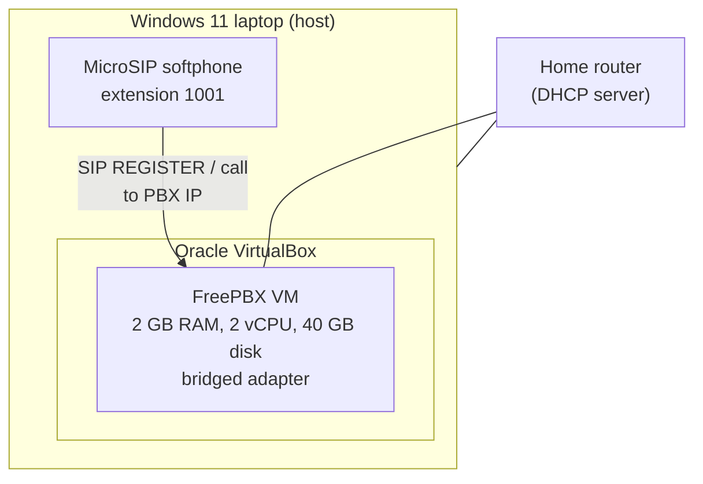
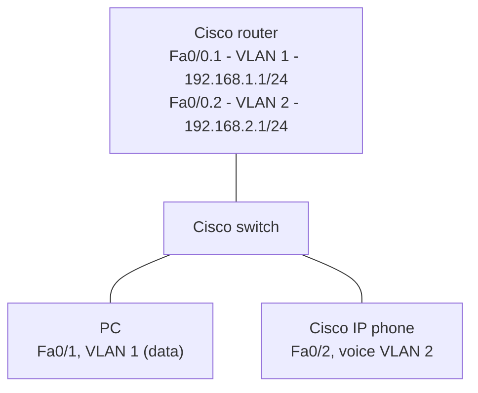

# Self-Hosted VoIP Home Lab with FreePBX

A working VoIP phone system built on a single Windows 11 laptop: FreePBX running in a VirtualBox virtual machine, a MicroSIP softphone registered to a SIP extension, and a validated test call. A second, optional part simulates the enterprise network side of VoIP (voice and data VLANs, router-on-a-stick, DHCP) in Cisco Packet Tracer.

Platform

Hypervisor

PBX

Protocol-blue)

## Contents

- Overview
- Objectives
- Technologies Used
- Skills Demonstrated
- Environment
- Lab Architecture
- Project Scope
- Repository Structure
- Setup Summary
- Configuration Reference
- Validation and Testing
- Troubleshooting
- Security Considerations
- Lessons Learned
- Future Improvements
- Author

## Overview

I wanted to understand VoIP by running a real phone system rather than reading about one. FreePBX is an open-source PBX built on Asterisk and is used in production by small businesses, so I deployed it on my own hardware from a blank starting point: install the hypervisor, build the VM, install the PBX, create an extension, register a softphone and place a call.

Part A covers that build. Part B is a separate Packet Tracer exercise covering the switching and routing configuration that normally surrounds a PBX in an office network, because I do not own enterprise Cisco switches, routers or IP phones.

> **Screenshot Placeholder**
> 
> 
> Insert screenshot here: `screenshots/freepbx-dashboard.png`
> 
> - **Expected capture:** FreePBX web dashboard after first login, browser address bar showing the server IP.
> - **Why it matters:** Shows the finished server at a glance and is the first thing a reviewer sees.
> - **Capture from:** Windows 11 browser, after logging in to the FreePBX web interface.

## Objectives

- Confirm the host laptop can run a second operating system reliably before building anything.
- Deploy FreePBX in VirtualBox with a VM sized for an 8 GB host.
- Give the PBX its own address on the home network using a bridged adapter.
- Create a PJSIP extension and register a softphone to it.
- Prove the full path works with a test call and a Call Detail Record (CDR) entry.
- Practise voice and data VLAN segmentation on Cisco IOS in Packet Tracer.
- Document the build step by step so it can be reproduced on similar hardware.

## Technologies Used

| Area | Technology |
| --- | --- |
| Host operating system | Windows 11 |
| Hypervisor | Oracle VirtualBox |
| PBX | Sangoma FreePBX Distribution ISO (Linux, Asterisk, FreePBX web interface) |
| SIP channel driver | PJSIP (`chan_pjsip`) |
| Softphone | MicroSIP |
| Network simulation (optional) | Cisco Packet Tracer, Cisco IOS CLI |
| Diagnostics | `ip addr show`, FreePBX CDR Reports, MicroSIP registration status |

## Skills Demonstrated

| Skill | Where it appears |
| --- | --- |
| Virtualization and VM resource sizing | Host readiness, VirtualBox and VM |
| Linux server deployment from ISO | FreePBX installation |
| Network modes (NAT vs bridged), DHCP, IP verification | VirtualBox and VM, FreePBX installation |
| PBX administration: extensions, apply-config workflow | FreePBX web setup |
| SIP registration and call validation, CDR review | Softphone and validation |
| VLANs, access and voice ports, router-on-a-stick, DHCP pools | Packet Tracer lab |
| Structured troubleshooting | Troubleshooting |
| Basic security practice (credential separation, certificates) | Security considerations |
| Technical documentation | This repository |

## Environment

| Item | Detail |
| --- | --- |
| Host machine | Intel Core i5 (4 cores), 8 GB RAM, 256 GB SSD |
| Host OS | Windows 11 |
| Hardware virtualization | Intel VT-x, shown as **Enabled** in Task Manager |
| Hypervisor | Oracle VirtualBox |
| Guest VM name | `FreePBX` |
| Guest type | Linux, Red Hat (64-bit) |
| Guest resources | 2 GB RAM (2048 MB), 2 vCPUs, 40 GB dynamically allocated VDI |
| Guest network | Bridged adapter on the host’s active Wi-Fi or Ethernet interface |
| PBX extension | `1001`, display name `My Softphone`, PJSIP |
| Softphone | MicroSIP on the Windows host |

I chose VirtualBox over Hyper-V because it is lighter on an 8 GB machine and works on Windows 11 Home as well as Pro. Giving the VM 2 GB leaves about 6 GB for the host.

## Lab Architecture

### Part A: FreePBX on the home network



The VM appears on the LAN as its own device and receives its own address from the router. In the documented run the console showed `192.168.1.149`; addresses will differ on other networks. See Architecture for more detail.

### Part B: Packet Tracer VoIP topology



Part B is a standalone simulation. It is not connected to the FreePBX VM.

## Project Scope

**In scope**

- Host readiness checks, VirtualBox install, VM creation and ISO installation of FreePBX
- Web interface login, administrator account creation, one PJSIP extension
- MicroSIP registration, Echo Test call (`43`) and CDR verification
- Packet Tracer topology with a voice VLAN, access ports, router-on-a-stick and per-VLAN DHCP

**Out of scope (not done in this project)**

- Calls between two extensions
- SIP trunks or calls to the public telephone network
- Voicemail, call recording, ring groups, call forwarding
- FreePBX firewall hardening or exposure beyond the home network
- Connecting the Packet Tracer network to the FreePBX VM

## Repository Structure

```
.
├── README.md
├── LICENSE
├── .gitignore
├── configs/
│   └── packet-tracer-voip-vlan.txt     Cisco IOS commands used in Part B
├── docs/
│   ├── architecture.md
│   ├── 01-host-readiness.md
│   ├── 02-virtualbox-and-vm.md
│   ├── 03-freepbx-installation.md
│   ├── 04-freepbx-web-setup.md
│   ├── 05-softphone-and-validation.md
│   ├── 06-packet-tracer-lab.md
│   ├── troubleshooting.md
│   ├── security-considerations.md
│   └── lessons-learned.md
└── screenshots/
    └── README.md                       Index of expected screenshots
```

## Setup Summary

The full procedure is split into numbered guides. Follow them in order.

| Step | Guide | Outcome |
| --- | --- | --- |
| 1 | Host readiness | CPU, RAM, storage, OS and VT-x verified |
| 2 | VirtualBox and VM | VirtualBox installed, ISO downloaded, VM created, ISO attached, bridged networking set |
| 3 | FreePBX installation | FreePBX installed, first boot, IP address confirmed |
| 4 | FreePBX web setup | Admin account created, extension 1001 created and applied |
| 5 | Softphone and validation | MicroSIP registered, Echo Test passed, CDR entry confirmed |
| 6 | Packet Tracer lab | Voice and data VLANs, inter-VLAN routing and DHCP verified (optional) |

## Configuration Reference

| Setting | Value |
| --- | --- |
| VM name | `FreePBX` |
| OS type / version | Linux / Red Hat (64-bit) |
| Memory | 2048 MB |
| vCPUs | 2 |
| Disk | 40 GB, VDI, dynamically allocated |
| Network adapter | Adapter 1, Bridged Adapter, host’s active physical interface |
| Boot media | Official Sangoma FreePBX Distribution ISO |
| Extension type | New SIP (Chan_PJSIP) Extension |
| Extension number | `1001` |
| Display name | `My Softphone` |
| Remaining extension options | Defaults |
| Softphone server | FreePBX VM IP address |
| Softphone username | `1001` |
| Softphone password | The SIP secret generated by FreePBX (not stored in this repository) |

Cisco IOS commands for Part B are in `configs/packet-tracer-voip-vlan.txt`.

## Validation and Testing

| Check | Method | Result |
| --- | --- | --- |
| Virtualization enabled | Task Manager, Performance, CPU | Virtualization: Enabled |
| VM boots installed system | Reboot after install | FreePBX console reached with no install or boot errors |
| VM has its own LAN address | Console banner and `ip addr show \| grep "inet "` | Valid IPv4 address on the host’s network |
| Web interface reachable | Browser to the VM IP | Setup page loaded after accepting the self-signed certificate warning |
| Extension registration | MicroSIP account status | Registered |
| Call signalling and media | Dial `*43` (Echo Test) | Greeting heard, own voice echoed back (two-way audio) |
| Call recorded by PBX | FreePBX Reports, CDR Reports | Echo Test call listed |
| VLAN separation (Part B) | DHCP on PC and IP phone | PC received a `192.168.1.x` address, IP phone a `192.168.2.x` address |

Details and screenshot placeholders are in Softphone and validation and the Packet Tracer lab.

## Troubleshooting

docs/troubleshooting.md covers four problems with the checks I use for each: VM not booting from the ISO, web interface unreachable, softphone not registering, and one-way or missing audio. It also records the general approach I follow: verify infrastructure, confirm the IP address, check credentials, apply pending changes, then test one component at a time.

## Security Considerations

This is a home lab on a private network, but I kept a few habits that carry over to production work: separate credentials for the Linux root account and the FreePBX administrator, a strong root password, a generated SIP secret kept out of this repository, and a note that the self-signed certificate would be replaced with a trusted one for anything reachable from the internet. See Security considerations, which also lists what was not hardened.

## Lessons Learned

- Check host prerequisites (VT-x, RAM, disk) before building, not after a failed install.
- Right-size the VM. More RAM is not better when the host starts paging.
- Bridged networking makes a VM behave like a real network device, which is what a PBX needs.
- FreePBX saves changes but does not activate them until **Apply Config** is clicked.
- Keep the first configuration simple so there are fewer variables when something fails.
- VLAN separation is a configuration decision, not a cabling one.

More in Lessons learned.

## Future Improvements

- Add extension 1002 and test extension-to-extension calls with a second softphone or phone.
- Explore voicemail, call transfer, call forwarding and ring groups.
- Set up a SIP trunk with a VoIP provider for external calls.
- Review FreePBX firewall and security settings before any exposure beyond the home network.
- Give the PBX a static address or DHCP reservation so the IP does not change after a lease renewal.
- Replace the self-signed certificate if the server is ever made reachable beyond the LAN.
- Tie the two parts together by placing the PBX behind the simulated voice VLAN design.

## Author

**Clinton Kehinde**
GitHub: @Heisdavein

This repository is part of my portfolio as I build toward an IT support and cybersecurity career.
